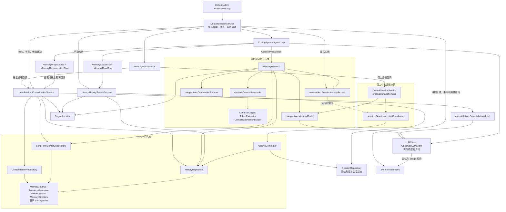

# Memory 包结构、逐文件职责与调用关系

`src/main/java/com/demo/memory` 共 37 个生产 Java 文件。根包保留 `MemoryHarness`、`ProjectLocator`、`MemoryMaintenance`、`MemoryTelemetry`，其余按职责放到六个子包。单个独立类不再单独建包。测试同步调整；请求准备职责已按审查方案拆分，会话持久化格式保持不变。

`agent.Conversation` 仅保存原始对话；请求准备合同和旧窗口策略位于 `memory.context`，由宿主显式传给执行循环。职责拆分依据见 [上下文职责审查](MEMORY_CONTEXT_REVIEW.md)，三步方案已实施。

## 包结构

```text
com.demo.memory/
├── ProjectLocator.java
├── MemoryMaintenance.java
├── MemoryTelemetry.java
├── MemoryHarness.java             请求前记忆入口
├── context/                       上下文、预算、协议块、会话记忆状态和准备策略（9）
├── compaction/                    增量压缩和宿主归档接口（4）
├── consolidation/                 长期知识提炼与候选裁决（2）
├── history/                       历史搜索、读取和来源校验（2）
├── model/                         跨流程共享的不可变数据（6）
└── storage/                       持久化、事务、格式与恢复（10）
```

`context` 的纯计算与状态不依赖存储或模型调用；`model` 不依赖提炼服务；`storage` 不依赖检索或提炼业务。memory 内部的子包依赖没有环。`CompressionState` 的覆盖边界校验需要 `ConversationBlockBuilder`，所以两者同放在 context，避免把状态放进 model 后产生 context/model 双向依赖。

## 逐文件与类说明

表中每行对应一个生产文件；同文件内有重要嵌套类、record 或 enum 的，也一并说明。标记“包内”的类保持包级可见性。

### 根包 `com.demo.memory`

| 文件/类 | 作用 |
| --- | --- |
| [MemoryHarness.java](../src/main/java/com/demo/memory/MemoryHarness.java) | 在每次编码模型请求前加载全局/项目有效条目、验证已提交摘要链，组装有预算约束的输入；需要时编排选取、摘要生成与宿主归档。`CompactionPhase` 发布压缩阶段；私有 `Attempt` 同时保存准备结果和预算报告，以判断是否能安全回退。它负责请求前路径，整个服务的后台调度和候选裁决由会话宿主接入。 |
| [ProjectLocator.java](../src/main/java/com/demo/memory/ProjectLocator.java) | 只读定位真实工作目录及最近 Git worktree 根，非 Git 时使用真实工作目录；识别 worktree/submodule 标记但不追随 Git common directory。`Project` 保存 workspace/root，并计算 `.coding-agent` 目录。只定位，不创建文件或扩大工具权限。 |
| [MemoryMaintenance.java](../src/main/java/com/demo/memory/MemoryMaintenance.java) | 单线程后台/手动维护执行器，负责首次扫描、dirty＋间隔资格、跳过运行中会话、会话失败退避、手动任务准入、取消和限时关闭。私有 `Failure` 保存退避次数与重试时间。实际归档/提炼通过宿主回调执行，不自行决定提交会话。 |
| [MemoryTelemetry.java](../src/main/java/com/demo/memory/MemoryTelemetry.java) | 汇总服务进程内按用途区分的实际模型尝试/重试、已知 Token、缓存及耗时，明确保留未知与不完整状态；维护最多 256 条项目过滤事件。`Origin/Operation/Phase` 分类事件；`Event/Page` 支持游标与 gap，`Usage` 是用量快照，私有 `Counter` 负责累加。只记录元数据，不把观测写入对话或长期知识。 |

### `context`：本轮发送什么，以及能否放下

| 文件/类 | 作用 |
| --- | --- |
| [ContextAssembler.java](../src/main/java/com/demo/memory/context/ContextAssembler.java) | 纯函数式地组合系统提示、全局记忆、项目记忆、连续摘要和未覆盖的完整消息；调用预算检查，返回 `ContextPreparation.Input`。不读盘、不调用模型、不修改原始消息。 |
| [ContextBudget.java](../src/main/java/com/demo/memory/context/ContextBudget.java) | 计算完整请求和各层记忆的限制，预留输出与安全余量。`Report` 给出分项 Token、触发/目标阈值和超限项；`Limit` 标识全局、项目、摘要、总输入或不可拆块超限。 |
| [TokenEstimator.java](../src/main/java/com/demo/memory/context/TokenEstimator.java) | 按 Unicode 码点、消息封装、工具参数及 schema 估算输入 Token。用于预算决策，不是真实 tokenizer，也不用于填补缺失账单 usage。 |
| [ConversationBlockBuilder.java](../src/main/java/com/demo/memory/context/ConversationBlockBuilder.java) | 把助手工具调用及匹配的工具结果组成不可拆协议块，拒绝孤立、重复或不匹配结果。`Block` 保存起止下标、消息和完整性；允许检查点尾部暂未完成，发送请求时仍须拒绝未完成块。 |
| [CompressionState.java](../src/main/java/com/demo/memory/context/CompressionState.java) | 保存已覆盖到的消息 ID、对应归档 ID、连续摘要和压缩版本。`coveredCount` 利用协议块校验覆盖边界；原始消息始终留在会话文件中。 |
| [SessionMemoryState.java](../src/main/java/com/demo/memory/context/SessionMemoryState.java) | 保存最后成功整理的内容版本、时间及压缩状态；计算 dirty、首次/间隔资格，并防止整理版本超过实际内容版本。只表达状态和资格，不负责扫描、模型调用或保存。 |
| [ContextBlockedException.java](../src/main/java/com/demo/memory/context/ContextBlockedException.java) | 表示预算超限、历史无效、摘要未提交、记忆不可用或压缩失败等可解释的请求受阻结果。`Reason` 分类原因，可附带 `ContextBudget.Report`，不会伪装成助手对话消息。 |

### `compaction`：将旧对话压缩成可继续执行的摘要

| 文件/类 | 作用 |
| --- | --- |
| [CompactionPlanner.java](../src/main/java/com/demo/memory/compaction/CompactionPlanner.java) | 选择尚未覆盖消息的连续旧前缀，保护当前用户请求和最近完整块，按照目标预算限定单次批量；不跨越或拆开工具协议块。 |
| [MemoryModel.java](../src/main/java/com/demo/memory/compaction/MemoryModel.java) | 用当前 `LLMClient` 发起无工具、COMPACTION 用途的结构化摘要请求。超长消息分片，校验六类连续摘要、来源和预算，格式错误最多修复一次。`Summary` 是完整批次输出；私有 `Fragment`/`Payload` 描述分片及累计摘要请求。全部片段成功前不提交覆盖边界。 |
| [SessionArchiveAccess.java](../src/main/java/com/demo/memory/compaction/SessionArchiveAccess.java) | 压缩流程依赖的宿主接口，提供 `snapshot`、`recover`、`commit`。实际实现是 memory 包外的 `session.SessionArchiveCoordinator`，确保归档后同时更新磁盘和活跃会话元数据。 |
| [CompactionException.java](../src/main/java/com/demo/memory/compaction/CompactionException.java) | `Reason` 分类模型失败、输出非法、来源输入过大和持久化失败。上层只有在完整输入依然满足预算时才可回退继续。 |

### `consolidation`：从历史提炼长期知识

| 文件/类 | 作用 |
| --- | --- |
| [ConsolidationModel.java](../src/main/java/com/demo/memory/consolidation/ConsolidationModel.java) | 将新增已提交 history 的独立归档摘要和现有条目交给模型，获得 ADD/UPDATE/INVALIDATE/IGNORE 提案；严格校验 JSON、条目、来源和输入预算。无工具调用，使用 CONSOLIDATION 用途，格式修复最多一次。 |
| [ConsolidationService.java](../src/main/java/com/demo/memory/consolidation/ConsolidationService.java) | 执行增量批次、去重、作用域/来源/版本/预算检查、准备计划恢复和游标推进；自动应用符合条件的项目知识，其余持久化为候选。还处理即时提案、显示与明确用户裁决。`Display` 固定已展示候选和当前旧值，后台新候选不能更换回复目标；全局更新必须明确批准。 |

### `history`：按需回忆已有工作

| 文件/类 | 作用 |
| --- | --- |
| [HistorySearchService.java](../src/main/java/com/demo/memory/history/HistorySearchService.java) | 绑定宿主项目，按中文片段/英文词项和关键词权重检索已提交归档，提供有界详情及可选原始来源。通过配置的 SessionRepository 核验项目、版本和连续覆盖消息，不接受任意项目路径。私有 `Scored` 保存排序分数，`Source` 保存来源可用性与已核验快照。 |
| [HistoryAccessException.java](../src/main/java/com/demo/memory/history/HistoryAccessException.java) | 检索服务的安全错误类型，`Reason` 区分关闭、项目不可用/改变、历史不可用和未找到；错误消息不带原始对话或文件路径。 |

### `model`：跨服务共享的数据合同

| 文件/类 | 作用 |
| --- | --- |
| [HistoryEntry.java](../src/main/java/com/demo/memory/model/HistoryEntry.java) | 一次增量归档的数据：身份/操作 ID、来源版本、覆盖消息、前一摘要、独立归档摘要、累计连续摘要、关键词、来源引用、时间和提示版本。校验基本结构，提供覆盖尾消息 ID。 |
| [MemoryItem.java](../src/main/java/com/demo/memory/model/MemoryItem.java) | 一个稳定 ID 的长期条目，含有效状态与正文；`Kind` 区分事实、规则、决策和偏好。校验 ID、非空正文及管理标记注入。 |
| [MemoryEdit.java](../src/main/java/com/demo/memory/model/MemoryEdit.java) | 一个条目级局部操作；`Action` 仅允许新增、更新、失效、忽略。限定各类操作的载荷，不接受任意文本补丁或路径。 |
| [MemorySource.java](../src/main/java/com/demo/memory/model/MemorySource.java) | 条目来源引用：history ID，或会话 ID＋消息 ID。record 校验身份结构，来源真实性和作用域由业务服务核验。 |
| [MemoryUpdate.java](../src/main/java/com/demo/memory/model/MemoryUpdate.java) | 一次可重试的存储请求：稳定 operation ID、预期文件版本、局部操作、来源、理由和时间。存储层据此执行 CAS、审计和去重；本身不授予全局写入权限。 |
| [MemoryProposal.java](../src/main/java/com/demo/memory/model/MemoryProposal.java) | 一个自动操作或持久候选的完整载荷，包含编辑、来源、预期版本等；`Scope` 区分 PROJECT/GLOBAL，并禁止自动全局写入。`update()` 转成保留同一操作 ID 的 `MemoryUpdate`。 |

### `storage`：可靠保存与中断恢复

该包已有紧密的包内协作，保留在一起，不把 Journal、Markdown 等包内实现扩大为公共 API。

| 文件/类 | 作用 |
| --- | --- |
| [LongTermMemoryRepository.java](../src/main/java/com/demo/memory/storage/LongTermMemoryRepository.java) | 读取长期 Markdown，预览/执行局部操作，检查文件版本，保存旧版本、事务和审计，支持幂等重试与恢复。`Change` 保存前后版本及操作，私有 `Transaction` 保存可恢复的前后镜像，`Step` 是提交检查点。 |
| [HistoryRepository.java](../src/main/java/com/demo/memory/storage/HistoryRepository.java) | 读写追加式归档日志，普通读取只返回有提交标记的条目。`Snapshot` 包含可见条目及不完整尾行标志；包内 `State` 重建身份索引和已提交集合，私有 `Commit` 表达提交标记。 |
| [ArchiveCommitter.java](../src/main/java/com/demo/memory/storage/ArchiveCommitter.java) | 协调归档事务、history 追加、会话 CAS 和最终提交标记，校验连续覆盖关系并支持操作 ID 去重。`Step` 表示四个检查点，`Recovery` 返回恢复计数，私有 `Transaction` 保存待完成归档。它处理磁盘事务，活跃 Session 的同步由宿主协调器负责。 |
| [ConsolidationRepository.java](../src/main/java/com/demo/memory/storage/ConsolidationRepository.java) | 原子保存提炼游标、候选、准备计划及裁决。`State` 是带 revision 的完整本地状态；`Decision` 记录裁决、真实回复和宿主会话。短锁＋CAS 后才能执行批准的全局写入副作用；此处不能调用模型。 |
| [MemoryDocument.java](../src/main/java/com/demo/memory/storage/MemoryDocument.java) | 读取或预览得到的不可变长期文件快照，包含是否存在、版本哈希、原文和解析后的条目。 |
| [MemoryMarkdown.java](../src/main/java/com/demo/memory/storage/MemoryMarkdown.java) | 包内 Markdown 解析/局部修改器，按稳定条目标记定位，保留非管理文本，拒绝损坏标记或重复 ID；私有 `Block` 保存条目在文档中的位置。 |
| [MemoryJournal.java](../src/main/java/com/demo/memory/storage/MemoryJournal.java) | 包内 JSONL 日志实现，以换行作为记录边界，支持取消读取、记录大小限制、截断尾行备份和恢复。`Event` 表示日志事件，`Read` 同时保留完整前缀字节数和未完成尾部。 |
| [MemoryJson.java](../src/main/java/com/demo/memory/storage/MemoryJson.java) | 包内 JSON/编码公共实现：Instant 适配、严格 UTF-8 解码、SHA-256 文件版本和错误归一化。 |
| [MemoryDirectory.java](../src/main/java/com/demo/memory/storage/MemoryDirectory.java) | 包内记忆目录约定，定义公共锁位置，在写入初始化时确保 `.gitignore` 忽略 `/local/`；普通读取不初始化目录。 |
| [MemoryStorageException.java](../src/main/java/com/demo/memory/storage/MemoryStorageException.java) | 存储错误合同，`Reason` 区分 IO、占锁、版本冲突、格式损坏、不支持版本和状态不一致。仓库把底层异常转换成这些原因，由宿主决定重试、暂停或提示。 |

## 调用关系图

下图表示核心运行调用，带“回调”的边通过宿主注入函数执行；虚线连接归档接口与其实现。不可变 record、异常及部分格式帮助类在上表中说明，不为它们画独立执行节点。



三条路径最值得区分：

1. **继续当前对话**：AgentLoop → MemoryHarness → 上下文组装；超预算压力触发压缩，经 SessionArchiveAccess 的宿主实现提交摘要，原始消息不删。
2. **回忆其他历史**：Agent 工具或 CLI → HistorySearchService → 已提交 history／来源会话。这条路径只读，不自动发摘要模型请求。
3. **整理成长期知识**：轮末、手动或后台回调 → ConsolidationService → ConsolidationModel → 局部操作或持久候选。项目自动写入受来源/版本/预算限制，全局操作等待明确批准。

后台归档通过宿主直接调用 MemoryModel 和 SessionArchiveCoordinator，**不经过 MemoryHarness 的前台请求准备入口**。MemoryMaintenance 决定何时运行，业务服务决定做什么，仓库决定怎样可靠落盘。

## 包外协作点

| 类/接口 | 与 memory 的关系 |
| --- | --- |
| `config.MemoryConfig` | 提供开关、预算、提炼阈值及维护间隔；不移入 memory，以保留统一配置归属。 |
| `session.DefaultSessionService` | 创建并注入各服务、调度轮末维护、协调前后台提交、处理 CLI 的查询与裁决。 |
| `session.SessionArchiveCoordinator` | 实现 SessionArchiveAccess，归档后同步活跃 Session 的 metadata，避免磁盘与内存版本分离。 |
| `session.storage.SessionRepository` | 保存原始对话及记忆状态，提供归档所需 CAS 和检索来源读取。 |
| `memory.context.ContextPreparation` | AgentLoop 每次请求前调用的准备钩子；传递同一请求快照、工具 schema 和预算报告。 |
| `llm.ObservedLLMClient` | 按请求连接实际客户端与 MemoryTelemetry，SDK 逐次报告真实尝试，支持并发前台/后台请求。 |
| `tools.builtin.Memory*Tool` | 把只读检索、即时提案及宿主绑定裁决暴露为模型工具；项目身份和用户批准由宿主控制。 |
| `cli.CliController / RunEventPump` | 处理 `/memory`、展示候选及维护事件，不把进度或用量追加为原始消息。 |
| `storage.StorageFiles` | 通用文件原语：安全子路径、短锁、原子替换、追加与持久化；不属于 memory 专用格式。 |

测试 fixture `SummaryFixtures` 随摘要测试迁入 `src/test/java/com/demo/memory/compaction`，其余单元测试同样跟随相应功能包；`memoryTest` 的递归匹配规则继续覆盖所有子包。

## 本次重构验证

- 源码与测试编译通过；移动前后比较未发现包声明、import 和全限定类型引用以外的方法体变化。没有变更方法可见性或持久化格式。
- 35 个生产文件均有上表对应条目，源码链接有效；未发现旧的生产类全限定引用或 memory 内部子包循环依赖。
- 使用 JDK 17 执行完整 build 与 memoryTest：全量 444 项（439 通过、5 跳过、0 失败/错误）；记忆专项 141 项全部通过，ZIP/TAR 分发产物生成成功。
- 首轮验证期间共享 build 目录被清空，随后通过本地 Gradle init script 将输出隔离到 `.gradle/memory-package-refactor/build`，重新编译并通过全部检查；该临时构建配置与产物均由 `.gradle/` 忽略。报告在该目录下的 `reports/tests/test` 与 `reports/tests/memoryTest`。
- `git diff --check` 通过；未调用真实模型 API，未运行 Docker/Harbor 评测，未提交或 push。
