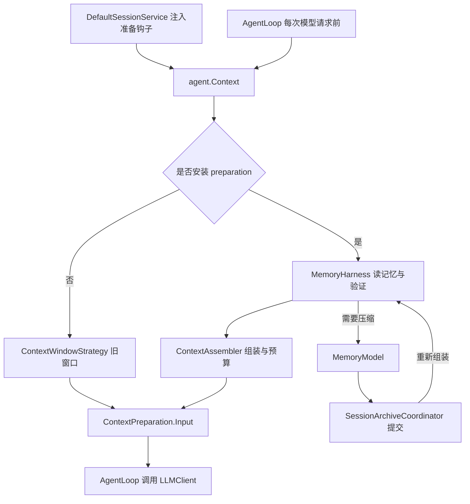
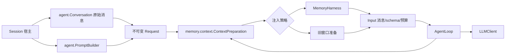

# Context 职责审查与修改方案

实施状态：以下三步方案已完成。`agent.Context` 已收缩并更名为 `Conversation`；准备合同和旧窗口策略迁入 `memory.context`，由执行循环显式调用；同一准备快照的协议块、覆盖边界和 Token 估算由嵌套 `Analysis` 复用。摘要提交后重新获取记忆状态并分析，来源验证和宿主 CAS 保留。当前链路见 [上下文组装与预算](MEMORY_CONTEXT.md)。

以下保留修改前的审查依据和验收要求。

## 当前各类的作用

| 类 | 实际职责 |
| --- | --- |
| `agent.Context` | 持有活跃会话原始消息和 contentRevision；委托 PromptBuilder 配置提示词/工具；选择旧窗口或宿主准备钩子；缓存最近预算报告。 |
| `agent.PromptBuilder` | 构造角色、工作目录、工具说明和 API 工具 schema。 |
| `agent.ContextWindowStrategy` | memory 未接入时使用的字符数/消息数窗口；保留完整工具块，并截断超长单条内容。 |
| `agent.ContextPreparation` | 请求前准备接口，当前接收整个可变 Context，返回消息、工具 schema、可选预算。 |
| `memory.MemoryHarness` | 读取记忆、验证摘要、调用组装器，必要时执行压缩模型请求，通过宿主接口提交归档，再重新组装。 |
| `memory.context.ContextAssembler` | 纯计算：组合各层记忆和近期完整消息，检查协议和预算；不读盘、不调用模型、不改变原始消息。 |
| `memory.context.CompressionState / SessionMemoryState` | 覆盖边界、连续摘要、整理游标等状态；不再持有一份原始对话。 |
| `session.Session / SessionArchiveCoordinator` | Session 持有 Context 和记忆状态；协调器保证磁盘归档与活跃会话元数据一致。SessionSnapshot 是持久化/并发读取快照，有独立用途。 |

因此 memory.context 接管的是“请求上下文的组装、预算及相关状态”，尚未接管整个会话和请求准备生命周期。Context 仍有必要保留的消息状态职责，但当前名称与职责过宽。

## 实际调用与问题判断

1. **没有双重裁剪或递归套娃。** Context.prepareForLLM 的两个分支互斥；启用 memory 后不会再调用旧窗口。AgentLoop 每个迭代只准备一次，随后直接发送同一 Input。压缩提交后重新组装是必要的，因为摘要版本发生变化。
2. **存在跨职责与包双向依赖。** Context 同时保存业务状态和执行请求准备策略；ContextPreparation 接受完整可变 Context，赋予 memory 超出读取快照所需的能力。agent 引用 memory 的预算/异常/协议块；MemoryHarness、ContextAssembler 又引用 agent.Context 或 ContextPreparation。问题在边界，而不是两份上下文互相调用。
3. **方法的副作用不直观。** buildMessagesForLLM 实际调用 prepareForLLM，并使用 CancellationToken.none；安装运行时准备钩子后，它可能间接读写磁盘、调用摘要模型和提交归档。当前生产 AgentLoop 使用有 token 的 prepareForLLM；该便利方法在生产调用点中没有外部使用者，但对未来调用者存在误导。
4. **预算缓存重复承担状态职责。** Input 已带报告，AgentLoop 直接用它发布 contextPrepared 事件；getLastBudgetReport 在生产代码中没有外部调用点。Context 无须再为报告维护独立字段及失败缓存分支。
5. **旧窗口与新预算是兼容路径，不宜直接删除。** 不接入 memory 的 AgentLoop 用法以及 memory 关闭场景仍需基础输入准备能力，应把两者放到同一个明确的策略入口。
6. **有局部重复计算，未发现重复发送。** CompressionState.coveredCount 解析协议块后，ContextAssembler 又解析近期消息；估算最大块和全部近期消息也会重复估算部分消息。MemoryHarness 的验证和 CompactionPlanner 亦需要覆盖边界。可复用同一快照的分析结果，但压缩提交后的重算不能去掉。

## 建议目标

让状态、准备策略和执行循环各有一个入口，沿用现有包，不增加单类子包。

- `agent.Conversation`：由现有 Context 收缩/改名而来，只保留消息、revision、恢复、追加、清空和读取快照。Session 继续拥有它，AgentLoop 负责追加模型和工具消息。
- `agent.PromptBuilder`：保留角色与工具提示构造职责，由宿主提供配置；不再经 Conversation 转发。
- `memory.context.ContextPreparation`：将现有接口迁入，内嵌不可变 Request、Input 两个 record。Request 包含系统提示、工具 schema、消息快照和 contentRevision；Input 保持消息、schema、预算。无需为每个 record 再建文件。
- `memory.context.ContextWindowStrategy`：迁入已有 context 包，作为关闭 memory 时的准备实现；与 MemoryHarness 实现二选一。
- `MemoryHarness`：仅接受 Request，不再引用 agent.Context；通过已有 SessionArchiveAccess 执行恢复/提交。SessionMemoryState 的获取和宿主协调接口继续显式注入。
- `AgentLoop`：显式调用注入的 preparation，消费 Input，再发请求；Conversation 不再持有 preparation 或预算缓存。准备过程必须传递当前取消 token。

此方案让 agent 可以依赖 memory.context 的输入准备合同，而 memory 不再依赖 agent。原始消息与记忆状态的持久化仍归 session，避免将会话生命周期塞进 memory.context。

## 分步实施与验收

### 第一步：收敛准备合同

迁移 ContextPreparation 到 memory.context；增加嵌套 Request，修改 ContextAssembler 的返回类型引用、MemoryHarness 的输入及相关测试。准备前捕获一次原始消息/revision/提示词/schema，禁止通过回调修改原始对话。压缩仅改变记忆状态；同一次准备中原始消息快照可保持不变，但每次提交后必须重新获取摘要状态。若宿主快照版本不符，沿用现有 CAS 拒绝提交，不能强行覆盖。

验收：memory 不再 import agent；准备前后原始消息和 contentRevision 不变；摘要提交、故障恢复、工具块完整性测试通过。

### 第二步：拆开状态与执行

Context 收缩为 Conversation，移除 PromptBuilder、preparation、lastBudgetReport 和旧窗口字段；更新 Session、CodingAgent、AgentLoop、AgentCheckpoint 与测试引用。宿主在运行入口显式传入 preparation 和提示词配置；直接构造 AgentLoop 的调用方使用旧窗口默认策略。保留必要的短期适配仅用于分批迁移，全部调用点迁移后删除，不长期维持两套入口。

移除 buildMessagesForLLM 这类隐藏副作用入口；报告通过 Input/事件传递，受阻报告通过异常传递。PromptBuilder 的旧别名根据实际调用点清理。无需修改会话文件格式、消息 ID、revision 语义或配置开关。

验收：每次编码模型请求恰好准备一次；memory 开/关均可运行；取消传递正常；受阻不写入伪助手消息；检查点和恢复仍保存完整原始对话。

### 第三步：复用同一快照的分析

在已有 context 文件中使用嵌套分析 record 保存协议块、覆盖下标及各块 Token 估算，供校验、组装和规划复用。优先消除一次准备内部的重复遍历；不先引入全局缓存。若后续确需缓存，键至少包含 contentRevision、压缩版本和影响预算的提示词/工具配置；不得仅凭消息数量复用。

验收：完整工具块边界、选择前缀和预算报告与原行为一致；压缩更新后重新分析必要数据；不以跳过来源验证换取性能。

每步运行普通离线测试、memoryTest 及构建；使用 fake LLM 验证准备次数、压缩和取消，不调用真实模型 API。不把本方案扩展成会话、存储或长期提炼重写。
